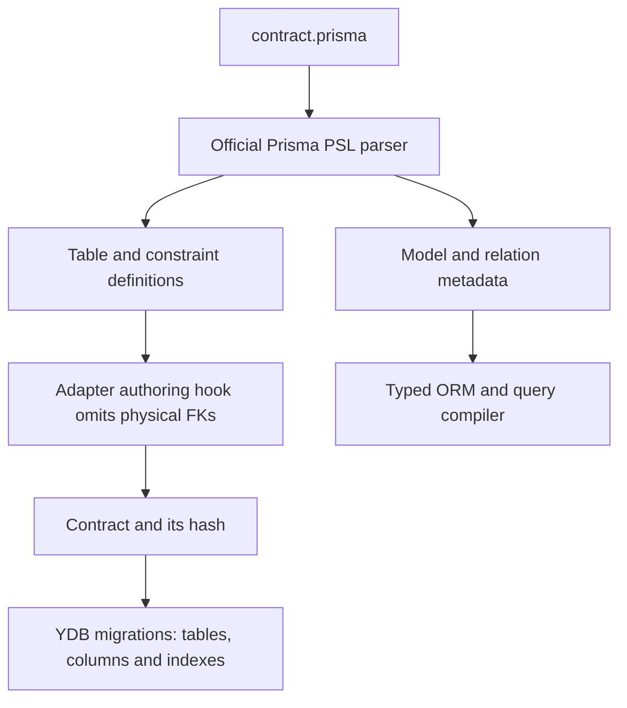

# Relations and referential integrity

`@relation` describes how the ORM finds related rows and derives their types.
**YDB does not enforce foreign keys.** Action-bearing relations use client-side
checks and deletion rules. Raw YQL and other applications bypass them.

## What each mechanism guarantees

| Mechanism                         | Provides                                             | Does not provide                                    |
| --------------------------------- | ---------------------------------------------------- | --------------------------------------------------- |
| `@relation` without actions       | Field mappings, includes, relation filters and types | Validation that every stored reference has a parent |
| Required scalar, such as `String` | A `NOT NULL` column                                  | Validation that the referenced row exists           |
| `@@index([projectId])`            | An index available for related-row lookups           | Referential integrity                               |
| Unique index                      | Uniqueness of indexed keys                           | Validation of references to another table           |
| `db.transaction()`                | Serializable execution of the operations you perform | Business checks you did not implement               |
| TypeScript / DTO                  | Compile-time shape checking                          | Validation of the current database contents         |

There is no global interceptor for arbitrary `*Id` fields. Reference checks apply
only to relations declaring supported actions. Other scalar writes can store
nonexistent parent IDs.

## Define a relation

```prisma
// use prisma-8
model Project {
  id    String @id @default(uuid())
  name  String
  tasks Task[]
}

model Task {
  id        String   @id @default(uuid())
  title     String
  done      Boolean  @default(false)
  createdAt DateTime
  projectId String?
  project   Project? @relation(fields: [projectId], references: [id], index: false)

  @@index([projectId])
}
```

Set `relationMode: 'application'` in `defineYdbConfig`. This explicitly enables
relations managed by the client. A relation without actions remains unenforced
query metadata; action-bearing relations install the checks described below.

`index: false` disables the relation's implicit index because this example
already declares its index with `@@index([projectId])`.



The adapter uses Prisma's `createNamespace` authoring hook. It retains relation
metadata and indexes while omitting physical FK constraints **before computing
the contract hash**. Action-bearing FKs remain ordinary contract metadata and
are excluded from physical schema projection, introspection and DDL.

Without `relationMode: 'application'`, a schema requesting physical FKs is
rejected. If authoring a TypeScript contract directly, use
`constraint: false`; that option is not a PSL `@relation` argument in the pinned
Prisma version.

## Client-side referential actions

```prisma
project Project? @relation(fields: [projectId], references: [id], onDelete: Cascade, index: false)
```

Declare `@@index([projectId])` to avoid scans during reference lookups. Supported
`onDelete` actions are Cascade, SetNull and Restrict. SetNull requires nullable
child columns. NoAction-only declarations are rejected: use Restrict for an
explicit guard. SetDefault is rejected. `onUpdate` accepts only NoAction/Restrict;
omitting it means NoAction. Cascade cycles, including self-relations, are rejected
because recursive deletion cannot be represented by one static YQL program.

A parent delete captures selected keys and applies guards, child deletes or
SetNull updates in the same YQL program and Serializable transaction. Composite
references join on all key columns. Restrict/missing-parent failures surface as
non-retryable `YDB.REFERENTIAL_ACTION`. Child INSERT/UPDATE/UPSERT operations check
that each non-null parent exists; a concurrent parent delete conflicts with that
read and one Serializable transaction aborts. Retry the whole transaction.
UPSERT-skip with implicit FK defaults is rejected.

Raw YQL, other services and relations without actions bypass this protocol.
Initially inconsistent data needs repair before enabling actions. Large cascades
still obey transaction/result limits; index the child FK columns. These checks
are client behavior, not database constraints.

### Read related rows

```ts
const projectSummary = db.orm.Project.fragment((projects) =>
  projects.select('id', 'name'),
);
const taskDetails = db.orm.Task.fragment((tasks) =>
  tasks
    .select('id', 'title')
    .include('project', (projects) => projects.with(projectSummary)),
);

const task = await db.orm.Task.with(taskDetails).where({ id: taskId }).first();
```

The compiler uses the mapping `Task.projectId = Project.id`. Nested results use
YQL joins and typed lists/structs. These queries need relation metadata, but they
do not require a database FK or repair inconsistent data.

An optional relation returns `project: null` when no parent is found. This can
mean either `projectId` is null or it contains a dangling reference. Select
`projectId` as well when diagnosing the difference. A to-many relation with no
matching children returns `[]`.

A required relation in TypeScript does not prove that every writer has maintained
the invariant. Do not use a required include as an integrity check.

## Create or change a reference

The manual recipes below apply to relations **without actions**, such as the
first schema above. Action-bearing relations perform these checks automatically.

Check the parent **inside the same transaction** that writes the child:

```ts
await db.transaction(
  async (tx) => {
    const project = await tx.orm.Project.select('id')
      .where({ id: projectId })
      .first();
    if (!project) throw new Error('Project not found');
    return tx.orm.Task.create({ title, createdAt: new Date(), projectId });
  },
  { retry: true },
);
```

To change `projectId`, check the new parent and update the task in one transaction.
A check through the root `db.orm` followed by a write through `tx.orm` is outside
this protocol: the read belongs to a separate transaction.

A nested ORM `connect` looks up the target record as part of its mutation graph.
That is a check for that ORM operation. It does not protect against a later
unconditional parent deletion. If a nested mutation fails inside
`db.transaction`, it invalidates the outer transaction. YDB has no savepoints;
catching the error cannot make a partially executed graph safe to commit.

## Choose a deletion policy

### Reject deletion while children exist

```ts
await db.transaction(
  async (tx) => {
    const project = await tx.orm.Project.select('id')
      .where({ id: projectId })
      .first();
    if (!project) return;
    const child = await tx.orm.Task.select('id').where({ projectId }).first();
    if (child) throw new Error('Project has tasks');
    await tx.orm.Project.where({ id: projectId }).delete();
  },
  { retry: true },
);
```

### Delete the children with the parent

For a bounded number of children, run
`tx.orm.Task.where({ projectId }).deleteAndCount()` and then delete the project
in the same transaction. ORM mutation counts use `RETURNING`, so result limits
still apply. This is an application operation, not an automatic cascade.

### Keep the children and clear their reference

For nullable `projectId`, run
`tx.orm.Task.where({ projectId }).updateAndCount({ projectId: null })`, then delete
the project in the same transaction. The same `RETURNING` limits apply.

Large graphs need a separate deletion workflow. One approach is to mark the
parent as deleting, reject new references to it, remove children in bounded
batches, then remove the parent. You must add the state and enforce this protocol
in every writer. Multiple transactions do not provide an atomic cascade.

## Concurrency: both sides must follow the protocol

Checking the parent during child creation alone is insufficient. A valid serial
execution could create the child first and then unconditionally delete the
parent. The result is a dangling reference despite Serializable isolation.

The protocol must cover **both child creation/reassignment and parent deletion**.
With initially consistent data and every writer following the checks above,
Serializable transactions coordinate the conflicting reads and writes. A
conflict can result in `ABORTED`; retry the whole transaction. A raw script or
another service that bypasses the protocol can still violate the invariant.
This is reasoning about the application protocol under
[YDB's isolation guarantees](https://ydb.tech/docs/en/concepts/transactions),
not an additional database constraint supplied by the library.

## Find dangling references

For the example schema:

```sql
SELECT t.id, t.projectId
FROM `Task` AS t
LEFT JOIN `Project` AS p ON t.projectId = p.id
WHERE t.projectId IS NOT NULL AND p.id IS NULL
LIMIT 100;
```

This is a diagnostic sample; paginate for a complete audit. Repair depends on
your business rule: restore the parent, clear the reference or delete the child.
The library does not choose a repair automatically.

## Other relation shapes

- **One-to-one:** use a unique index on the reference when at most one child may
  point to a parent. The index does not check whether that parent exists.
- **Many-to-many:** model an explicit junction table with a composite primary key
  for the pair of IDs. Check both references and define junction deletion rules.
- **Composite keys:** equality relations can use multiple corresponding fields.
  Reference checks must cover the entire key.
- **Self-relations and complex many-to-many graphs:** these are not covered by the
  extracted package's basic integration example. Validate the specific shape
  before relying on it.

`prisma contract infer` cannot reconstruct unconstrained relation metadata from
YDB. Keep the authored `.prisma` schema. A migration adding a reference column or
index does not repair existing dangling references; plan data repair separately.

Continue with [migrations](migrations.md), [transactions](transactions.md) and
[selections and DTOs](selections.md). See also the
[pinned Prisma ORM API](https://github.com/prisma/orm/blob/v8.0.0-rc.18/packages/3-extensions/sql-orm-client/README.md).
